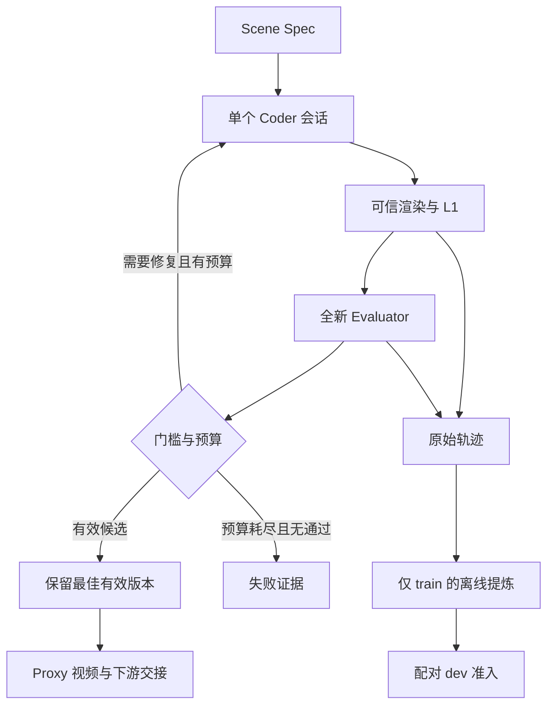

# Proxy Video Harness v1

面向 **VLM / Coding Agent → Three.js → proxy video → 下游视频模型** 的研究原型。

这份实现把成熟 Coding Agent CLI 作为执行内核，用 Python 管理确定性流程、受保护的 Three.js 运行时、程序化验收、独立 VLM 评审、原始证据和离线技能准入。没有重新实现底层 tool-calling loop。

**已验证真实浏览器渲染与视频导出；本环境的嵌套 Codex 启动被只读运行状态目录阻断，未声称完成真实模型生成闭环。** `validation/demo` 是手写场景的基础设施演示；`validation/live_smoke` 保存真实 CLI 启动失败证据。具体版本、测试数量和已知限制见 [VALIDATION.md](VALIDATION.md)。

## 1. 已实现的模块

| 模块 | 入口 | 行为 |
|---|---|---|
| 规格规划 | `plan` / `spec.py` | 现成 CLI 输出 Scene Spec JSON；结构与语义校验，手写 Spec 同样可用 |
| 单写者编码 | `engine.py` | Codex 非交互模式；用精确 session id 连续修复；另有 JSON argv 通用适配器 |
| 确定性场景 | `assets/runtime.js` | `renderAt(t)`、真实几何 manifest、顶视图；固定本地 Three r180 |
| 简洁原语 | `assets/primitives.js` | 中性材质、box/sphere、粗粒度人偶、贴地与轨道相机等帮助函数 |
| 无头渲染 | `render.py` | 独立超时进程、本地资源服务、外网请求阻断、canvas 截图、Contact Sheet、MP4 |
| L1 验收 | `checks.py` | 运行错误、乱序一致性、主体注册、投影/视锥、相机、支持形状的精确碰撞 |
| 独立评审 | `evaluate.py` | 每轮全新请求；Codex 或兼容 Chat Completions 的视觉接口；评分格式验证 |
| 编排 | `orchestrator.py` | 最多 4 轮、硬门槛封顶、局部修复反馈、最佳有效版本保护 |
| 离线外循环 | `outerloop.py` | 仅 train 轨迹进入提炼，候选资产绑定、完整配对 dev 准入，输出报告 |
| 下游交接 | `handoff` | 输出 `proxy.mp4`、主体外观绑定提示词与规格；不猜测 MiniMax/H3 接口 |



## 2. 从零运行

需要 Python 3.11+、FFmpeg，以及能够启动的 Chromium。Three.js 已随项目固定版本交付，渲染时不访问 CDN。

```bash
cd proxy-harness-v1
python3 -m venv .venv
source .venv/bin/activate
python -m pip install -r requirements.txt
python -m playwright install chromium --only-shell
python -m proxy_harness doctor
python -m proxy_harness demo --out runs/demo --video
```

Linux 若缺系统依赖，按 Playwright 官方安装说明安装浏览器依赖。FFmpeg 需要单独安装到 PATH。

若已有浏览器，可显式指定可执行文件；不要仅凭 `which chromium` 判断安装成功：

```bash
python -m proxy_harness demo --out runs/demo-explicit \
  --browser /absolute/path/to/chromium --video
```

本项目在无 GPU 环境使用 `--use-gl=angle --use-angle=swiftshader --enable-unsafe-swiftshader`。没有添加 `--disable-gpu`。`--backend native` 可用于本机 GPU 或已配置的 Mesa 环境；v1 不替你安装或验证 llvmpipe。SwiftShader 适合受控场景测试，完整的不可信代码服务仍应放在独立容器或等效 OS 隔离中；浏览器请求拦截不等于操作系统级安全边界。

演示应得到 `hard_pass: true`、`status: unverified`。这是有意的：手写模板没有经过真实模型生成和独立 VLM 评分，不能计为研究任务成功。

## 3. 接上真实模型

### Codex 编码 + 独立 Codex 视觉评审

先在自己的可写 CLI 环境完成安装与登录。项目不会改动全局认证文件，也不会关闭 CLI 的权限控制。

```bash
codex login status
python -m proxy_harness run \
  --spec devset/train/train_01_static_pair.spec.json \
  --config configs/codex.json \
  --out runs/train-01 --video
```

`configs/codex.json` 默认使用 CLI 当前配置的模型。为了可复现实验，正式跑批前显式填写 `coder.model` 和 `evaluator.model`，固定 CLI 版本及配置环境。两者可以使用相同模型，但不会共享对话历史。Coder 使用 `workspace-write`，Evaluator 使用新建临时证据目录、`read-only` 和 ephemeral 会话。

CLI 评审输入经过隔离，但其工具及全局配置仍由本地 CLI 管理。若需要**严格无工具的评审上下文**，使用下面的 HTTP 评审器。

### Codex 编码 + HTTP VLM 评审

复制 `configs/http-evaluator.example.json`，填写服务商实际支持的视觉 Chat Completions 地址与模型。通过配置指定的环境变量提供密钥。项目只保存变量名，不把 Authorization header 或环境中的密钥写进轨迹。

每轮请求只有固定 rubric、当前 Scene Spec、L1 报告、Contact Sheet 和顶视图，没有上一轮 messages、coder 的推理历史或源代码。兼容性由实际服务决定；示例参数 `response_format` 可按服务商文档调整。

### Claude Code / OpenCode 等其他 CLI

`configs/command.example.json` 是适配器协议，不是已实测的 Claude/OpenCode 参数配方。实现一个薄 wrapper，把现成 CLI 的 headless 模式映射到：

- `argv` 为首次调用，`resume_argv` 为继续指定会话；通过 argv 数组启动，`shell=False`。
- 提示词同时通过 stdin 和 `{prompt_file}` 提供；工作目录为 `{workspace}`。
- 将最终消息写入 `{output_file}`，或输出一行 `{"type":"result","session_id":"...","text":"..."}`。
- Coder 在工作目录编辑 `scene.html` 和 `appearance_prompt.txt`。
- Evaluator wrapper 必须消费 `{images_json}` 中的图片，并创建新会话。

不要把 `--last` 当作固定实验的恢复机制；它可能接到别的任务。

## 4. 从文本规划到下游交接

```bash
python -m proxy_harness plan \
  --prompt "低机位观察一个球从两根柱子之间滚过，球和两根柱子始终完整入画" \
  --config configs/codex.json --out specs/rolling-ball.json

python -m proxy_harness run \
  --spec specs/rolling-ball.json --config configs/codex.json \
  --out runs/rolling-ball

python -m proxy_harness handoff \
  --run runs/rolling-ball --out exports/rolling-ball
```

只有真实独立评审通过的 `accepted` 运行可以 `handoff`。交接时还会重新渲染和验收选中的版本。

交接目录包含 proxy MP4、`appearance_prompt.txt`、Scene Spec 和 `handoff.json`。**v1 没有调用 MiniMax/H3，也没有验证任何特定 H3 部署的 video-to-video、ControlNet 或结构条件输入。** 确认你实际使用的 checkpoint / 推理服务及输入契约后，再写一个后端适配器；图片参考生成不应被当作完整 proxy 视频条件控制。

## 5. 对原方案做的关键修正

### 确定性是可重复的时间定位契约

`renderAt(t)` 会更新对象、相机并渲染，严格说不是无副作用的纯函数。约束是：相同初始配置、同一运行后端和同一 `t`，不依赖此前调用顺序，得到相同状态及像素。所有动画使用绝对时间，固定随机种子，不使用墙钟或增量积分。

渲染器对全部采样时间建立基准，再按种子打乱顺序重复检查像素哈希与 manifest 哈希。这是**采样验收**，不是对任意实数时间、跨显卡、跨浏览器版本像素一致性的数学证明。运动突变、碰撞或镜头切换应在 Spec 中增加事件附近的样本。

### AABB 重叠不能判定穿模

支持的窄相位检测：球–球、OBB–OBB（SAT）、球–OBB。Exact collider 必须来自受保护运行时检查过的真实标准球/盒网格；非均匀缩放球体、剪切、改写顶点、多网格组合没有这类精确保证。

其他形状只有 AABB 重叠时输出 `collision_unverified` 警告，交给额外的几何工具或视觉检查。复杂人物的 Box3 不会被误当作人体表面的精确碰撞。仅检查 Spec 显式列出的 forbidden pairs，并尊重活动时间区间和接触容差。

### 视锥相交不能证明可见

L1 分别检查注册主体、相机前方、视锥、投影是否有效，以及任务明确要求的完整入画和大小范围。屏占比是**裁剪到视口的投影顶点包围矩形面积**，不是实例分割面积，不证明没有遮挡。真正的可读性与多主体遮挡由独立视觉评审判断。

`3%–70%` 没有写成通用阈值。每个主体可设自己的范围、是否完整入画和活动区间。背景/地面不会被强制要求满足主角的屏占比。

### 低机位和仰拍分别测量

相机 `position.y` 表示高度；`pitch_deg` 表示视线相对水平面的仰角，向下为负。低相机不必然仰拍，地平线或对象位置也不能单独推断镜头要求。Spec 可以同时约束高度与角度。

### Manifest 由实际几何派生

模型只提供场景和对象注册。受保护的 `runtime.js` 计算包围盒、相机数据、投影和支持形状的 collider；记录未注册 mesh。Controller 在每轮后检查受保护资产哈希，始终用自己的可信资产重新渲染。Scene Spec 和评估脚本不会让 Coder 自行改写。

## 6. 通过、失败与最佳版本

正常运行的通过条件同时包含：

1. Coder 正常退出、两个输出文件完整、受保护文件未变化。
2. L1 `hard_pass=true`。
3. 独立 Evaluator 返回合法评分，`subject_complete=true`。
4. 有效分数达到该任务的 `pass_score`。

L1 失败时分数由代码封顶，VLM 的高分无权覆盖。未配置或调用失败的 VLM 不会收到默认及格分。每轮反馈包括可定位的时间、主体 ID、失败原因和修复建议；修复时也把上一轮图片交给 Coder。

最佳有效版本优先级为“L1 + 独立评审主体完整”之后的得分。如果最好版本只有 60 分而门槛为 75，最终仍为 rejected；会保留该版本供诊断，但不会交给下游。没有任何有效候选时 `best_valid_iteration=null`，`evidence_dir` 只是诊断版本。

## 7. 原始轨迹

每次运行目录必须为空，防止覆盖旧证据。每一轮有独立快照。关键文件如下：

| 文件 | 用途 |
|---|---|
| `spec.json` / `config.json` | 固定任务与运行配置 |
| `assets_snapshot/` / `protected_hashes.json` | 本次真实使用的运行时与依赖版本 |
| `iter_00/scene.html` / `appearance_prompt.txt` | 本轮完整代码及主体外观绑定 |
| `diff.patch` | 相对上一轮的真实源码变更 |
| `coder_prompt.txt` / `coder.stdout.jsonl` / `coder.stderr.log` | CLI 可获得的原始提示、事件和错误 |
| `coder_result.json` | exit code、会话 id、耗时、实际 argv |
| `frames/` / `contact_sheet.png` / `top_view.png` | 原始采样图和评审图 |
| `manifests.json` / `determinism.json` | 每帧几何测量与乱序重复证据 |
| `render_meta.json` / `console.log` | 浏览器后端、版本与运行错误 |
| `l1_report.json` / `eval.json` | 程序化门槛及独立评分 |
| `eval_request.json` / `eval_response.json` | 可复查的评审输入及原始返回 |
| `eval_wire_request.json` | HTTP 后端完整请求体，含图片内容、不含认证头 |
| `history.json` / `summary.json` | 各轮状态与最终选择 |
| `best_valid/` | 最佳有效快照；未达总分门槛也不会伪装成 accepted |

这里的 Raw Traces 指保留可获得的原始外部证据和 CLI 事件，不要求模型暴露其私有思维链。文件在运行目录中保持可直接读取；交付时的压缩包只是传输容器。

## 8. 数据集、离线技能提炼与准入

`devset/` 含 **6 train + 24 dev + 6 holdout** 原创任务与固定哈希。它是启动用的工程测试集，不是对 CodeVideoBench 的忠实复现，也不提供人类质量标注。

```bash
python -m proxy_harness batch --split train --config configs/codex.json --out experiments/train-v1

python -m proxy_harness distill \
  --batch experiments/train-v1/batch_results.json \
  --staging experiments/candidate-01 --name candidate-01 \
  --config configs/codex.json --execute

python -m proxy_harness bind \
  --staging experiments/candidate-01 \
  --assets experiments/candidate-01/candidate_assets

python -m proxy_harness batch --split dev --config configs/codex.json --out experiments/dev-baseline
python -m proxy_harness batch --split dev --config configs/codex.json \
  --assets experiments/candidate-01/candidate_assets --out experiments/dev-candidate

python -m proxy_harness admit \
  --baseline experiments/dev-baseline/batch_results.json \
  --candidate experiments/dev-candidate/batch_results.json \
  --proposal experiments/candidate-01/proposal.json \
  --assets experiments/candidate-01/candidate_assets \
  --out experiments/candidate-01/admission.json
```

提炼请求只带经核对的 train 原始轨迹；成功和失败都可以成为证据。候选只允许修改 `primitives.js` 或 `skills/` 中的项目技能，不能通过修改检查器、运行时、测试集或阈值“提高分数”。技能元数据进入 `skills-index.json`，Coder 按需读取正文，不把所有技能塞进每轮提示词。

准入核对完整任务集合、种子、规范化 Spec 哈希、运行配置、harness 哈希及资产条件绑定；同时回读真实运行证据，不能只填一张成功率表。质量门槛和主体完整度不得退步；代码行数/图元数只在质量合格后参与比较。缺任务、缺真实评审、候选资产未绑定或比较条件改变都会拒绝准入。

准入产出报告，**不会直接覆盖主资产**。通过后使用 `--assets` 指向该候选进行留出集测试，再按项目的版本管理流程合入。v1 没有宣称完成多批次技能蒸馏实验或获得泛化提升；Trace2Skill 的多分析器并行归并也没有被完整复现。

## 9. 消融与测试

已有 `configs/ablation-no-feedback.json`、`configs/ablation-no-l1-gate.json`。也可设置 `independent_eval=false`，或者将 `max_iterations=1` 测量单轮基线。

为了不让消融版本误流入正式资产，消融运行单独记录 `is_ablation` 和每轮 `experiment_accept`，不能被准入程序当作正常 accepted。移除 L1 gate 的配置仍计算、保存 L1，便于比较“裁判高分但几何失败”的比例；它会改变实验停机条件，不删除诊断数据。

```bash
python -m unittest discover -s tests -v
PROXY_BROWSER=/absolute/path/to/chromium python -m unittest discover -s tests -v
```

浏览器边界用例需要浏览器路径才执行；默认单元测试不调用模型、不消耗模型费用。测试 mock 不会被作为 train/dev 模型成功样本。

## 10. 参考工作与实现范围

- [CodeVideoModel](https://github.com/code-video-model/CodeVideoModel)：参考“现成 Coding Agent + 确定性 Three.js 时间定位 + 视觉反馈 + proxy 输出”的工程组织。
- [3DCodeVerse](https://github.com/gaoypeng/3dcodeverse)：参考把执行、几何测量、视觉判断和修复组织为领域工具的思路。
- [Trace2Skill](https://github.com/Qwen-Applications/Trace2Skill)：参考从原始成功/失败轨迹提炼可迁移技能并约束合并的思路；本项目提供较小的 staging/admission 外循环。
- [Codex non-interactive mode](https://developers.openai.com/codex/noninteractive/)：CLI 事件与指定会话继续。
- [Chromium SwiftShader](https://chromium.googlesource.com/chromium/src/+/main/docs/gpu/swiftshader.md)：显式 CPU WebGL 后端。
- [Playwright screenshots](https://playwright.dev/python/docs/screenshots)：通过 canvas locator 捕获画面。

本项目是针对这条研究路线的独立 v1 实现，不是上述仓库的完整移植，也不保证复现论文指标。Three.js 的 MIT 许可证和依赖哈希保留在 `assets/vendor/`。
